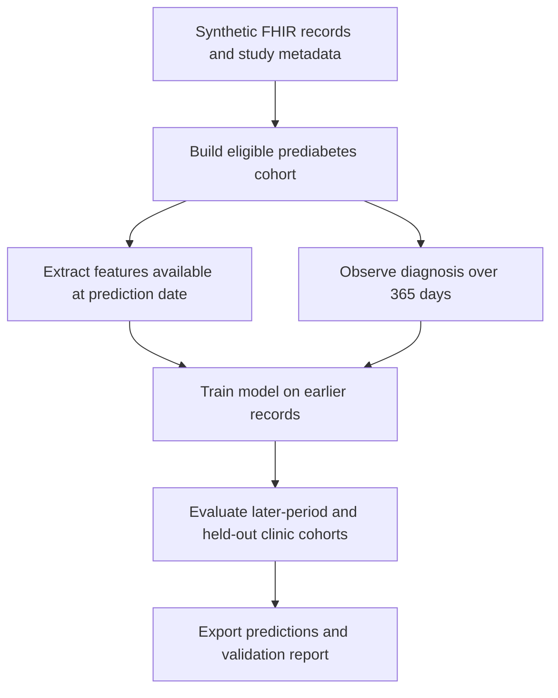

# Cardiometabolic Risk Toolkit

**A Research prototype for reproducible chronic-disease risk modeling with synthetic FHIR R4 data.**

This project demonstrates how to turn longitudinal health records into a traceable prediction study. It generates synthetic patient histories, constructs a cohort of adults with recorded prediabetes, trains a baseline model, and evaluates performance on patients from a later time period and a held-out simulated clinic.

The first release studies one question:

> Among adults with recorded prediabetes at a defined prediction date, what is the probability of a first recorded type 2 diabetes diagnosis within the next 365 days?

The endpoint is a **recorded diagnosis**. Its timing can reflect when a condition was detected, documented, or coded. In a real study, those factors would affect how the results should be interpreted.

## Table of contents

- [Project goals](#project-goals)
- [Quick start](#quick-start)
- [How the pipeline works](#how-the-pipeline-works)
- [Study design](#study-design)
- [Generated outputs](#generated-outputs)
- [Sample use cases](#sample-use-cases)
- [Reading the validation report](#reading-the-validation-report)
- [Repository structure](#repository-structure)
- [Testing and reproducibility](#testing-and-reproducibility)
- [Limitations and future work](#limitations-and-future-work)

## Project goals

Chronic-disease risk modeling depends on decisions that happen before a model is trained. A research team has to define who enters the cohort, decide which information was available on the prediction date, establish how the future outcome is observed, and check whether results hold across settings. This project makes those decisions visible in code and documentation.

The toolkit demonstrates how to:

- Represent synthetic patient histories using FHIR R4 `Patient`, `Condition`, and `Observation` resources.
- Convert dated clinical records into a longitudinal analysis cohort with a defined prediction date and follow-up window.
- Exclude information that was unavailable at prediction time, including results measured earlier but issued later.
- Train an interpretable logistic regression model and compare it with a constant-risk baseline.
- Evaluate discrimination and calibration on a later-period cohort and at a clinic excluded from training.
- Report age subgroup results with sample sizes and event counts.
- Regenerate the cohort, predictions, and validation report from a documented random seed.

The broader research direction covers cardiometabolic conditions, with diabetes as the first implementation and cardiovascular risk as a potential extension.

## Quick start

Use Python **3.11 or 3.12**. Run the commands from the repository folder.

### macOS or Linux

```bash
python -m venv .venv
source .venv/bin/activate
python -m pip install -r requirements.txt
python risk_study.py
```

### Windows PowerShell

```powershell
python -m venv .venv
.\.venv\Scripts\Activate.ps1
python -m pip install -r requirements.txt
python risk_study.py
```

The default run writes the generated files to `build/demo/`. To reproduce the default seed in a different output directory:

```bash
python risk_study.py --seed 42 --out build/reproduction
```

To verify the cohort and feature timing rules:

```bash
python -m unittest discover -s tests -v
```

The demo generates its own input records and runs locally. It requires no healthcare account, FHIR server, or patient data.

## How the pipeline works



1. **Generate the input records.** The simulator creates patients, diagnoses, and dated A1c observations. It also creates separate study metadata for each patient's clinic, prediction date, and observation end date.
2. **Construct the cohort.** Each included patient has recorded prediabetes, no recorded type 2 diabetes diagnosis by baseline, and enough simulated follow-up to observe the full outcome window.
3. **Build baseline features.** The pipeline calculates age, the latest eligible A1c, and the change from the preceding eligible A1c on a distinct measurement day.
4. **Assign the outcome.** A positive outcome is a first type 2 diabetes diagnosis recorded from day 1 through day 365 after baseline.
5. **Train and evaluate.** Imputation, scaling, and model fitting use the training cohort. Predictions are then generated for the two evaluation cohorts.
6. **Write auditable outputs.** The evaluation CSV includes the prediction date, features, source record ID for the latest A1c when available, recorded outcome, and synthetic risk score.

## Study design

| Component | Rule used in this release |
|---|---|
| **Unit of analysis** | One row per eligible synthetic adult |
| **Prediction date** | The index date in the synthetic study metadata |
| **Baseline eligibility** | Age 18 or older, recorded prediabetes on or before the index date, and no recorded type 2 diabetes by that date |
| **Follow-up** | At least 365 days of simulated observation after the index date |
| **Outcome** | First recorded type 2 diabetes diagnosis from day 1 through day 365 |
| **Model inputs** | Age in completed years, latest eligible A1c, and change from the preceding eligible A1c on a distinct day |
| **A1c eligibility** | Final result in UCUM percent, measured within the 365-day lookback and issued by the index date |
| **Missing values** | Training-cohort median imputation, with missingness indicators learned from the training data |
| **Prediction model** | Logistic regression |
| **Comparator** | A constant probability equal to the diabetes event rate in the training cohort |

### Why the issue date matters

A lab can be performed before the prediction date and become available afterward. Including that result would let the model use information it would not have had at the time of prediction. The toolkit checks both the measurement date and the issue date. It also includes deliberately outcome-correlated future labs to test whether the feature pipeline excludes them.

### Training and evaluation cohorts

| Cohort | Simulated clinics | Prediction period | Purpose |
|---|---|---|---|
| Training | North and South | 2022 | Fit preprocessing and train the model |
| Later-period evaluation | North and South | 2024 | Evaluate on different patients at the same simulated clinics in a later period |
| Held-out clinic evaluation | Coastal | 2024 | Evaluate on patients from a clinic excluded from training |

The Coastal simulation has a higher underlying event probability and more missing historical A1c values. Its results reflect a **combined site and time shift**. The supplied experiment cannot isolate the contribution of either shift.

See the [study protocol](docs/study-protocol.md) for the complete cohort definition, feature timing rules, and assumptions about follow-up.

## Generated outputs

| File | What it contains | How to use it |
|---|---|---|
| `synthetic-fhir.json` | FHIR R4 collection of simulated patients, conditions, and A1c observations | Inspect source records or trace an observation by resource ID |
| `study-metadata.json` | Simulated clinic, index date, and observation end date per patient | Verify cohort assignment and the follow-up window |
| `evaluation-predictions.csv` | Evaluation patient IDs, split, age, A1c features, source record IDs, outcomes, and risk scores | Audit a prediction or analyze results by site |
| `validation-report.json` | Cohort counts, model and baseline metrics, calibration bins, and age subgroup summaries | Compare model performance and interpret evaluation differences |

The repository includes the [sample report from the default run](docs/sample-validation-report.json). That run included **3,534 eligible synthetic patients** across training and evaluation cohorts.

## Sample use cases

### 1. Trace an A1c feature back to its source

**Scenario.** A health data engineer wants to verify that an A1c value in the evaluation table came from a result available on the prediction date.

1. Run the demo and open `build/demo/evaluation-predictions.csv`.
2. Choose a row with a populated `latest_a1c_record`.
3. Find that resource ID in `build/demo/synthetic-fhir.json`.
4. Compare the observation's `effectiveDateTime` and `issued` dates with the row's `index_date`.
5. Confirm that the resource references the same patient and that its value matches `latest_a1c`.

**What this demonstrates.** A reviewer can trace a model input back to a specific source observation and verify its availability at baseline.

### 2. Check whether future information leaks into the model

**Scenario.** A reviewer wants to test whether the pipeline accidentally uses an A1c recorded after the prediction date or a result issued after baseline.

1. Run `python -m unittest discover -s tests -v`.
2. Inspect the test that changes future A1c values and verifies that the generated cohort rows remain identical.
3. Inspect the test that delays the issue date of an otherwise eligible A1c and verifies that the result is excluded as the latest feature.

**What this demonstrates.** The tests cover two different paths for information leakage. One is a measurement made after baseline. The other is a result measured earlier but unavailable at baseline.

### 3. Compare the model with a simple baseline

**Scenario.** A researcher wants to know whether individual features add information beyond assigning every patient the training cohort's event rate.

1. Open `validation-report.json` and find `evaluation.later_period`.
2. Compare `logistic_regression` and `constant_baseline` on the same cohort.
3. Start with Brier score to compare probability error. Lower is better.
4. Review AUROC and average precision to assess how the model ranks patients.
5. Compare mean predicted probability with the observed event rate and examine the calibration bins.

**What this demonstrates.** A model can improve risk ranking while still misestimating absolute risk. Comparing both discrimination and calibration gives a more complete picture.

### 4. Examine how the model transfers to a different clinic

**Scenario.** An analytics team wants to understand how a model trained at North and South behaves at Coastal.

1. Compare `evaluation.later_period` with `evaluation.held_out_site`.
2. Review the sample size and event rate for each evaluation cohort.
3. Compare mean predicted probability with the observed event rate. A mean prediction below the observed rate indicates average underprediction in that cohort.
4. Inspect the calibration bins and their counts to see where the largest differences appear.
5. Compare Brier score and discrimination across the two cohorts.

**What this demonstrates.** A model can retain some ability to rank patients by risk while its probability estimates become less reliable when outcome rates or data availability change.

### 5. Review performance by age group

**Scenario.** A validation reviewer wants to know whether the aggregate report hides differences between patients under 65 and patients aged 65 or older.

1. Open `age_subgroups` for each evaluation cohort.
2. Start with `n` and `events` to understand how much information each subgroup contains.
3. Compare observed and predicted risk, Brier score, and discrimination where available.
4. Check whether an apparent difference is concentrated in bins with few patients or events.

**What this demonstrates.** Subgroup summaries help identify questions for further evaluation. This synthetic experiment does not establish clinical fairness or quantify the uncertainty around subgroup differences.

### 6. Reproduce the study and inspect sensitivity to the simulation seed

**Scenario.** A collaborator wants to check that the report can be regenerated and see how much results change across synthetic samples.

```bash
python risk_study.py --seed 42 --out build/seed-42
python risk_study.py --seed 123 --out build/seed-123
```

Compare the seed-42 report with the checked-in sample. Then compare the two runs on cohort size, event rate, calibration, and model performance. A changed seed produces a different simulated patient sample under the same generation rules.

**What this demonstrates.** A seeded run supports reproducibility, while multiple seeds can reveal sensitivity to simulation sampling. Neither establishes performance on real-world patient data.

## Reading the validation report

| Field | Interpretation |
|---|---|
| `n` and `events` | Number of evaluated patients and recorded diabetes outcomes. Check these before interpreting other metrics. |
| `observed_rate` | Fraction of evaluated patients with the recorded outcome. |
| `mean_score` | Average predicted probability. Compare it with the observed rate to assess overall underprediction or overprediction. |
| `auroc` | How often the model ranks an event patient above a nonevent patient. It measures ranking, independent of a decision threshold. |
| `average_precision` | Summary of precision across recall levels. Interpret it in the context of the cohort's event rate. |
| `brier` | Average squared error between predicted probabilities and observed outcomes. Lower values indicate lower probability error. |
| `calibration_bins` | Groups of predicted probabilities showing the patient count, average score, and observed event rate in each populated bin. |

The report uses `null` for discrimination metrics when an evaluated group contains only one outcome class. A single-class group does not support an event-versus-nonevent ranking comparison.

## Repository structure

| Path | Purpose |
|---|---|
| `risk_study.py` | Synthetic FHIR generation, cohort construction, model training, evaluation, and output export |
| `requirements.txt` | Pinned numerical and modeling dependencies |
| `tests/test_study.py` | Tests for cohort partitioning, incomplete follow-up, future measurements, and delayed lab results |
| `docs/study-protocol.md` | Detailed endpoint, feature definitions, evaluation design, and limitations |
| `docs/sample-validation-report.json` | Validation output generated with the default seed |
| `docs/github-publishing.md` | Repository description, topics, and release information |

## Testing and reproducibility

The included tests verify that:

- Each included patient appears once, the held-out clinic is assigned to its own evaluation split, and training rows come from the designated earlier period.
- Patients with incomplete simulated follow-up are excluded from the fixed-horizon cohort.
- Changing future A1c values leaves the generated cohort rows unchanged.
- Delaying the issue date of an otherwise eligible result excludes that result from the baseline feature selection.

The default seed is `42`. For a repeatable run, use the same seed and the dependency versions in `requirements.txt`. The bundled sample report reproduced byte for byte on a second run in the development environment.

## Limitations and future work

- **Simulated performance.** The generator deliberately relates age and A1c to the future outcome. The measured performance reflects that design and has no established clinical validity.
- **Outcome ascertainment.** The endpoint depends on a recorded diagnosis. A real study would need to define how it handles diagnosis coding, incomplete prior history, differences in screening frequency, and patients who receive care elsewhere.
- **Follow-up selection.** The prototype excludes patients with incomplete observation through day 365. A real evaluation would assess selection bias and consider methods that explicitly handle censoring.
- **FHIR scope.** The extractor supports the resource subset generated by the project. Production integration would require broader profile validation, terminology mapping, date and time normalization, and record reconciliation.
- **Generalizability.** The held-out clinic is synthetic. External validation requires an appropriate independent cohort and authorized access to longitudinal records.
- **Evaluation uncertainty.** The prototype reports point estimates and subgroup counts. Confidence intervals, prespecified subgroup analyses, and repeated external evaluations belong in a more mature study.

Future work includes evaluating the protocol on appropriately authorized longitudinal data, testing model transportability across independent sites, studying federated evaluation, and creating a separate monitoring workflow for data quality, calibration, and drift over time. Cardiovascular risk is a candidate for a separate endpoint with its own cohort and validation protocol.

**Intended use:** Research and education. All patient records and risk scores in the demo are synthetic. The toolkit is unsuitable for patient care or clinical decision-making.
